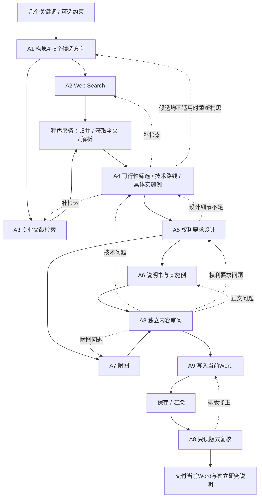

# 专利工作台实施规划

日期：2026-11-16。状态：规划。

## 1. 目标与已确定选择

输入系统、设备或方法相关的几个关键词；系统自主构思候选方向，检索专利与论文，选择可行、易实现的方案，形成技术路线、具体实施例、权利要求和说明书，输出供专利事务所继续修改的 DOCX。

- 一个任务中台，九个专业 Agent，共享项目数据；模块化单体，单机起步。任务调度、下载、解析、去重和文件保存由程序服务完成。
- React + TypeScript 前端；Python + FastAPI 后端；LangGraph 编排；PostgreSQL + pgvector；本地文件目录。
- OfficeCLI 作为唯一默认 DOCX 写入工具，通过其原生 MCP 接入。
- 专利检索考虑两个平台，一个是知网，一个是国知局（https://pss-system.cponline.cnipa.gov.cn/conventionalSearch）。
- 通用网页检索采用 Exa 官方 MCP；论文检索复用 Paper Search MCP；Google Patents 检索复用 google-patents-mcp 作为补充通道。
- 通用检索中有价值的信息若需全文搜索，可以通过MCP接入知网和国知局网站进行专利全文的下载，下载爬虫因为有学校官方账号购入数据库权限，属于正常行为。
- 现阶段先搭建项目、工作流、Agent 节点和工具接入框架，再开展端到端验证。
- 首期使用一个模型完成不同角色工作；提取、检索与审阅可以独立替换模型。
- 当前只输出本地文件。

## 2. 当前核查结果与待验证点

本机已执行 `officecli --version`，结果为 1.0.160；`officecli help mcp` 确认 `officecli mcp` 可启动 stdio MCP 服务。`help docx revision/comment` 列出了修订和批注接口，包括批注回复、解决状态，以及明确的修订创建操作。

## 3. 实际工作流

1. 材料理解：对输入的关键词先进行头脑风暴，思考4-5个创新点，形成标题和想法，通过检索和筛选返回的结果确定方案。
2. 并行检索：Web Search Agent 用 Exa 发现相关专利页面、论文、技术报告和公开文件；专业文献检索 Agent 查询论文与专利来源，取得题录和真实摘要。两者共享技术范围和术语，但各自保存查询式、来源与检索时间。
3. 合并与初筛：程序按 DOI、公开号、平台记录 ID 等合并结果；两个检索 Agent 提供相关性理由与获取优先级。优先获取高相关项，也保留代表性技术分支，避免只看关键词排名。
4. 全文获取：程序服务按已有文件 → 开放全文 → 已授权平台接口 → 自动入库执行；无需独立的下载 Agent。知网具体按账号可用授权路径执行。
5. 全文解析：PDF/HTML 经 Docling 解析；保留原文件、页码、段落、表格和图位置。
6. 技术路线与实施例设计：技术分析 Agent 比较候选方案与已有技术的区别，结合数据可获得性、实现难度、资源需求和输出可观察性选定方案，明确输入、步骤、输出、条件及具体实施例。
7. 权利要求设计：权利要求 Agent 根据技术方案和实施例组织独立项、从属项及说明书展开要求。
8. 说明书与附图：写作和绘图读取同一版技术方案、实施例和术语，形成正文与附图；实施例写清场景、条件、参数和执行过程，结果与结果图按实际资料补入。
9. 审阅修正：程序检查编号、公式、引用与缺失对象；独立审阅 Agent 检查技术与文本逻辑，输出问题与负责修正的节点，不直接改正文。默认最多两轮自动修正，其余保留在工作报告，不允许生成副本文件，在同一文件上修改。
10. Word 装配：Word 编辑 Agent 复制事务所模板，使用 OfficeCLI 写入内容与图、处理样式并保存；渲染服务生成预览，审阅 Agent 只读检查，版式问题回给 Word 编辑节点。
11. 事务所返稿：导入为新版本，读取批注/修订；技术、权利要求和正文问题交给对应 Agent，Word 编辑 Agent 在返稿副本中应用修改，输出修订稿和回复说明。

摘要用于初筛，全文用于技术对比；仅有摘要的记录保留 abstract_only 状态。下载失败项展示题名与原因，支持人工补充，其他研究任务继续执行。

## 4. 九个 Agent 的实现与职责边界

系统以几个关键词启动研究，例如“船舶、储能、故障恢复”，自主完成问题发现、候选构思、检索比较、方案选择和实施例设计。技术交底、代码、图纸及已有结果作为可选补充。

每个 Agent 实现为一个 LangGraph 节点或小子图，包含角色提示词、类型化输入输出、可用工具和调用循环。九个角色共用一个模型，在模块化单体内运行。模型负责构思、检索判断和方案综合，程序服务负责调度、下载、解析、去重、编号和状态保存。

| 编号 / 节点 | Agent | 输入 | 主要工具 | 输出 |
|---|---|---|---|---|
| A1 / ideation | 关键词理解与选题构思 | 用户关键词、可选约束、已有研究进度 | 项目上下文读取、已有候选与问题查询 | 研究范围、术语、4–5个候选标题与想法、技术问题、初步实现条件和检索假设 |
| A2 / web_search | Web Search | 候选方向、关键词与同义词、补检索问题 | Exa MCP 的网页检索与页面读取能力 | 公开技术线索、相关专利与论文页面、技术报告、来源片段、相关理由、全文线索 |
| A3 / literature_search | 专业文献检索 | 候选方向、技术问题、分类/日期等范围 | Paper Search MCP、google-patents-mcp、知网/国知局连接器、题录导入 | 原始题录与摘要、最接近文献、专业检索记录、全文获取优先级 |
| A4 / technical_analysis | 技术路线研究与方案设计 | 候选想法、摘要筛选结果、已解析全文、可选用户材料 | 项目内检索、证据片段读取、参数/公式检查；按需调用已实现的轻量计算工具 | 候选对照与选择理由、选定方案、区别特征、技术路线、实现条件、具体实施例、补检索或改案请求 |
| A5 / claims | 权利要求设计 | 系统设计的技术方案、特征对照、具体实施例 | 技术特征与来源查询 | 独立项/从属项、依附关系、特征覆盖、说明书展开要求、需要A4补充的设计细节 |
| A6 / specification | 说明书写作 | 选定方案、权利要求、具体实施例、统一术语 | 项目方案、来源和段落查询 | 分节正文、具体实施例章节、摘要、附图说明、段落与技术特征关联 |
| A7 / figures | 附图与图表 | 技术方案与实施例的步骤、模块、连接关系、标号及已提供结果 | Graphviz、Matplotlib、已有图纸读取 | 流程图/模块图/结构示意、可编辑图源、图号与附图说明要点；按结果资料生成数据图 |
| A8 / review | 独立审阅 | 设计方案、实施例、现有技术证据、权利要求、正文、附图和页面预览 | 只读查询、文档结构读取、确定性检查结果 | 问题定位、理由、建议、负责节点、复核结果、事务所批注回复建议 |
| A9 / word_editor | Word 编辑 | 待装配内容、模板或返稿、明确修改项 | OfficeCLI MCP、渲染服务 | 当前工作DOCX、样式与排版、文内修订/批注、应用结果、预览 |

### 4.1 从关键词到选定方案

1. A1 将关键词扩展为场景、对象、技术问题和中英文检索词，提出4–5个机制或处理关系不同的候选方向。每个候选包含标题、问题、初步机制、实现条件和检索假设。
2. A2/A3 并行检索相关技术及可能覆盖该构想的方案。程序归并记录，保留候选与文献的对应关系，复用已取得全文。
3. A4 根据摘要初筛，并获取高相关文献全文；围绕技术区别与实施可行性建立候选对照表。
4. A4 优先选择核心机制清楚、数据或设备可获得、实现工作量适中、能形成具体实施例的一个主方向，保存选择理由与备选方案。
5. 遇到核心机制重合、关键输入难以获得或实现代价过高的方向，A4调整技术路线、补检索或切换备选；必要时由A1重新构思。
6. 选定方案进入实施例设计，再交给A5组织权利要求。达到本轮研究上限时，保存当前成果、选择理由及待解决问题。

候选筛选使用以下对照项，每项给出依据和实现条件：

| 对照项 | 选案时需要回答的问题 |
|---|---|
| 技术区别 | 与已检索的接近方案相比，改变了哪些结构、步骤或协同关系？ |
| 输入可获得性 | 所需数据、设备状态或材料从哪里获得，格式与精度是否满足要求？ |
| 实现难度 | 能否利用现有软件、算法、部件或设备完成，新增工作集中在哪里？ |
| 资源与条件 | 需要哪些运行环境、设备和资源，当前能否具备？ |
| 实施例具体程度 | 能否确定一个场景、参数配置和完整执行过程？ |
| 输出可观察性 | 方法执行后输出什么，能否记录为明确的数值、状态、表格或图？ |

### 4.2 技术方案与具体实施例

A4为选定方向形成两项相互对应的成果。

**技术方案**说明技术问题、适用对象、模块连接、步骤依赖、输入输出、变量公式、约束、触发条件及必要的异常处理，并解释区别特征与技术效果的关系。

**具体实施例**将技术方案落实到至少一个明确场景，包含：

- 应用对象、运行场景和初始条件。
- 数据或材料来源、输入字段、格式及代表性输入的选取方式。
- 设备/软件配置、关键参数、取值依据和适用范围。
- 逐步执行过程、关键中间量和判断条件。
- 输出内容及记录形式，以及对应权利要求中的技术特征。
- 结果与结果图的位置和资料状态，尚未取得的内容统一标记“待补结果”。

方案选择与实施例设计联动：关键数据或条件无法落实时，A4先调整方案或转向备选，再展开正文。设计参数标明依据，实际结果关联来源文件。

已有技术、系统设计和用户资料分别记录。技术检查覆盖步骤完整性、输入输出匹配、变量定义、约束兼容、公式量纲和图文一致性；有益效果围绕技术机制说明，量化结果引用实际资料。

### 4.3 协作、回退与写入边界

A4负责技术方案与实施例，A5组织保护范围，A6撰写正文，A7制作附图，A8只读审阅，A9按明确修改项写入Word。技术或保护范围的调整先由A4/A5处理，再同步到正文和附图。

| 审阅问题 | 负责节点 | 更新后必须检查的关联内容 |
|---|---|---|
| 检索遗漏、相近方案重合、依据不足 | A2/A3补检索，A4重选或改案 | 技术路线、权利要求、说明书、附图 |
| 实现条件不足、实施例不具体、输入缺失、公式/约束冲突 | A4 | 实施例及A5/A6/A7涉及部分 |
| 必要特征缺失、依附错误、说明书缺乏展开 | A5，必要时A4/A6 | 权利要求与对应说明书段落 |
| 术语、描述、章节或实施方式矛盾 | A6 | 相关权利要求、附图说明 |
| 连线、标号、步骤或图示不一致 | A7 | 附图说明和正文引用 |
| 样式、分页、图片遮挡 | A9 | 保存后的页面预览 |

研究阶段的补检索/改案与文稿阶段的自动修正各最多两轮，程序累计记录轮次和用量。网络请求与模型格式错误单独有限重试。

全文按完成顺序进入A4分析；新增资料触发相关候选、实施例或段落的局部更新，其他获取任务继续执行。

节点输入包含project_id、研究轮次、候选/方案ID、input_version、目标及相关资料；输出使用Pydantic类型描述内容、来源、设计参数、问题及受影响对象。

## 5. MCP与程序工具接入

接入五个现成MCP，按角色提供工具；内部程序服务直接调用。接入时通过能力发现取得工具名称与参数，建立以下映射。

| 连接 | 使用方 | 接入内容 |
|---|---|---|
| Exa官方MCP | A2 | https://mcp.exa.ai/mcp；通用网页检索与页面读取，发现候选方向相关的论文、专利和公开技术材料 |
| Paper Search MCP | A3；下载服务按能力复用 | 复用已提供的论文来源连接器，获取题录、摘要和开放全文线索；各来源缺失字段与访问失败分别记录 |
| google-patents-mcp | A3 | 复用KunihiroS/google-patents-mcp及其SerpApi连接；作为Google Patents补充查询通道，分别保存搜索片段与原始摘要 |
| Playwright MCP | 知网/国知局连接器 | 本地浏览器页面交互、查询、会话复用与文件获取；固定流程由平台适配代码执行 |
| OfficeCLI MCP | A9写入；A8只读 | 启动本机officecli mcp，复用文稿读写、样式、批注与修订；应用侧限制各角色可用操作 |

知网与国知局连接器复用学校账号可用的登录会话和查询、下载入口。接入时确认各平台的认证方式、字段和文件格式，并保存连接状态。

优先使用免费访问与既有额度，记录调用用量并复用结果。未配置Key、额度耗尽或来源不可用时，显示原因并继续其他来源；购买由用户决定。

FastAPI、Worker和MCP客户端运行在用户Windows电脑，数据库可放容器；stdio服务由本地Worker启动，Exa等远程连接通过现成MCP SDK接入。浏览器会话与OfficeCLI留在本机。

应用内部只增加必要的薄适配：

| 内部能力 | 主要输入 | 返回内容 |
|---|---|---|
| 网页/论文/专利查询 | 候选ID、查询词、过滤条件、页码/游标 | 来源记录、真实摘要或网页片段、查询记录、下一页状态 |
| 来源页面读取 | 记录ID或来源URL | 正文片段、来源、访问状态 |
| 全文获取 | 记录ID、可用连接、优先级 | 文件ID、获取状态、错误原因 |
| 文件解析与入库 | 文件ID、对应文献ID | 页/段落/表格/图定位、解析状态 |
| 项目内证据查询 | 候选/方案ID、问题、来源范围 | 原文片段、定位、原文与概述的区分 |
| 结构与公式检查 | 技术方案、权利要求、正文、附图引用 | 结构、变量、公式和引用问题及位置 |
| Word修改与渲染 | 当前文档ID、输入版本、明确修改项 | 写入结果、文档版本、页面预览 |

MCP结果保存到数据库和文件目录，模型按需读取摘要及相关片段。下载、解析、渲染由后台服务执行，通过job_id更新进度。

## 6. 知网、国知局的全文获取与研究资料处理

### 6.1 自动获取主路径

1. A2/A3提供文献标识、页面地址、候选关联与获取优先级；程序合并重复获取任务。
2. 优先复用本地已获取全文，再尝试开放全文和账号连接可用入口；知网与国知局各自维护连接器，不混用会话或字段。
3. 用户首次在专用浏览器中完成学校机构/个人账号登录，后续任务复用有效会话；正常查询和下载连续执行，不逐篇要求确认。
4. 登录失效、扫码、验证码或二次认证时仅对应连接等待用户处理，其他来源和已取得材料继续工作。额外充值或购买不自动执行。
5. 程序监听实际下载完成事件，将文件关联到检索记录，再验证格式、可解析性和题名/公开号等标识，防止将登录页或同名不同文献入库为成功全文。
6. 成功的PDF/HTML进入Docling解析，保留原文件与页码/段落位置；失败项展示文献题名、来源和具体原因，可继续自动尝试其他已有来源。

密码与Cookie不进入模型上下文或Git；浏览器配置留在本机用户目录。每个浏览器profile串行执行任务，账号权限、会话和下载状态由服务管理。

连接器记录账号访问范围及平台规则；验证码、访问受限或限流时暂停对应连接并显示原因，由用户恢复会话或服务按平台提示重试。

### 6.2 缺失与格式处理

- 原始摘要、网页片段和模型概述分别保存，摘要缺失时保留空值。
- CAJ保留原件并按独立格式处理；转换能力尚未接入时显示待处理，其他PDF继续解析。
- 原文、译文与模型概述分别保存，论文预印本/正式版和专利不同公开版本各自保留标识。
- 同族专利归组展示，保留各自公开日和文本；现有技术检索同时覆盖有效与失效专利的公开内容。
- 人工补文件是可选恢复路径；用户补充后自动接入原记录并继续分析，不从头新建一轮研究。
- 受限全文用于项目内分析，事务所默认取得来源链接、书目信息和技术对照；原始全文是否附带按具体来源可分享范围处理。

## 7. 项目状态、研究数据和当前文档

以关键词研究任务为中心组织候选、技术方案、实施例和文稿，使用关系表、JSON字段、主键、外键、事务和版本号管理。

| 数据对象 | 保存内容 |
|---|---|
| projects | 用户原始关键词、可选约束、研究范围、当前阶段、选定方案ID |
| candidates | 4–5个候选标题、问题、初始机制、候选状态、筛选/放弃理由及关联文献 |
| sources / source_passages | 查询记录、平台标识、原始摘要、全文文件、页段定位、版本和获取状态 |
| technical_schemes / features | 技术路线、模块/步骤/公式/参数、区别特征、实施例的场景/输入/配置/过程/输出、结果资料状态及依据 |
| claims / sections / figures | 权利要求与依附关系、正文、附图源、术语标号及其关联的方案版本 |
| review_issues | 问题位置、证据、负责节点、处理状态、复核结果 |
| documents / jobs | 当前工作文件、返稿批次、版本号、节点输入输出版本、调用记录、轮次、用量、失败与恢复位置 |

候选状态使用proposed、screened、selected、revised、discarded，记录各阶段的选择理由和实施条件。

技术特征标明文献披露、系统设计或用户提供等来源；实施例分别保存设计参数和实际结果，关联适用条件与资料文件。

引用关系贯通：候选→来源→技术特征→权利要求→说明书段落→附图。改变技术方案时，程序将相关对象标为需要更新，由对应节点局部修正；无需把未受影响的正文全部生成一遍。

### 7.1 同一文件修改

每个项目维护一个当前工作DOCX，自动审阅和修正持续更新该文件。数据库版本号、修改记录与Word文内修订保存过程信息。

首次从模板创建工作文件；每批事务所返稿保留收到的原件并建立一个工作副本，该批次后续修改持续写入同一副本。

初稿由方案与结构化正文驱动装配；返稿以收到的DOCX为编辑依据，解析数据作为索引。同一DOCX由A9串行写入；版本检查发现用户修改时，先重新读取相关段落再应用更新。

优先用段落ID/书签定位，其次匹配文字与上下文；多义位置交由用户定位，插入删除后刷新路径。OfficeCLI resident模式在外部读取或渲染前执行save/close。

## 8. 专利正文、Word交付与返稿

### 8.1 实施例与说明书

将具体实施例作为本项目专利稿的必备章节。A4提供实施例的场景、输入、配置、参数和执行过程，A5建立与权利要求的对应关系，A6将其展开为可理解、可执行的说明，A7制作相应附图。

实施例按“场景与条件→输入与配置→执行步骤→输出与结果”组织。正文交代关键中间量和判断条件，使读者能够沿步骤理解方案如何落地。结果资料状态沿用第4.2节的统一标记；取得资料后补入对应段落、表格与结果图。

正文集中表达技术问题、技术方案、具体实施例和技术效果。检索台账、候选选择理由及待补问题放入独立研究说明。A7制作流程图、模块图和必要示意，数据图使用已提供的实际结果；图源、标号和术语与正文保持一致。

### 8.2 Word装配和修正

首次：模板→创建当前工作DOCX→OfficeCLI写入章节、公式、表格和附图→保存→结构读取与渲染→A8只读复核→A9在同一工作文件修正。

优先使用事务所模板，暂缺时采用内部简洁模板。文字、表格和公式保持可编辑，图源另行提供。OfficeCLI HTML/PNG用于快速预览，最终在Word/WPS中检查分页和审阅信息。

返稿采用原有Word对象上的局部编辑，保留批注、修订作者和时间。OfficeCLI的revision.beforeLost提示格式快照重建限制，因此复杂返稿沿用原文档结构。接受或拒绝已有修订按用户明确指令执行。

### 8.3 事务所返稿

读取返稿批注/修订后，由A8归类并路由：技术方案问题到A4，权利要求到A5，正文到A6，图到A7，版式到A9。对应节点先形成修改内容和回复建议，A9再应用显式修订和批注回复。完成后A8复核问题是否解决。

无法处理的复杂对象保留原状并给出定位建议；需要用户决定的保护范围变化进入问题列表，其他工作继续执行。

### 8.4 交付物

- 当前专利工作稿.docx：包含权利要求、说明书、具体实施例和附图；返稿处理后的同一工作稿保留修订。
- 研究与技术对照.docx：候选筛选结果、可行性分析、来源链接、最接近方案、区别特征、问题和回复说明。
- 附图源文件及图片：保留可编辑源与正文使用版本。
- 预览.pdf：选定渲染路径后生成的辅助预览，正式可编辑交付仍为Word。

交付说明列出本轮完成内容、实施例资料状态与剩余问题。

## 9. 开发任务、依赖与验收

先搭建项目、工作流、九个Agent和工具接入，再贯通关键词驱动的研究任务；节点随开发完成必要验证。

| 编号 | 任务与交付物 | 依赖 | 验收 |
|---|---|---|---|
| T01 | FastAPI、前端、项目/文件目录、数据库、本地Worker | 无 | 只输入几个关键词即可创建并启动项目；附件全部可选；显示研究阶段与当前成果 |
| T02 | LangGraph九节点、程序服务节点、候选分支、共享状态、有限回退 | T01 | 4–5个候选可流转并按技术区别与实施条件自动选案；回退复用已有成果并累计轮次 |
| T03 | 五个现成MCP连接、角色工具权限、平台适配接口 | T01 | 可以发现工具、按角色调用并保存结果；缺Key/待登录/失败显示真实状态 |
| T04 | A1关键词理解与构思，A2/A3并行检索，结果归并 | T02/T03 | 无技术路线输入仍生成4–5个实质不同候选，取得真实检索结果；摘要和模型概述分开 |
| T05 | 知网/国知局会话、全文获取、解析、可选人工接续 | T03/T04 | 账号可访问文献进入资料库；下载失败显示题名；CAJ/HTML误下载可识别；局部失败不阻塞其他来源 |
| T06 | A4可行性比较、自动选案、技术路线和实施例设计 | T04/T05 | 明确数据/设备来源、实现条件、步骤与输出；至少形成一个包含场景、输入、参数和执行过程的具体实施例 |
| T07 | A5权利要求、A6说明书与实施例、A7附图 | T06 | 权利要求在说明书和实施例中得到展开，步骤与图文一致，结果及结果图有对应资料或待补标记 |
| T08 | A8审阅与按责任回退、A9 OfficeCLI写入、渲染 | T03/T07 | A8只读，A9唯一写入；技术问题回A4；最多两轮文稿修正；同一稿件路径更新 |
| T09 | 返稿批次导入、批注回复、局部修订 | T08 | 保留原有审阅信息，不以旧正文覆盖返稿；该批次工作副本持续更新，不每轮另存 |
| T10 | 关键词驱动端到端验证与修正 | T04–T09 | 从关键词到可编辑Word的完整过程实际运行；人工只在必要的账号/支付/歧义处理环节介入；明确剩余问题 |

实施顺序：T01→T02/T03→T04→T05→T06→T07→T08→T09→T10。T02/T03可并行开发；运行时A2/A3并行，A6/A7在同一方案版本上并行；下载解析按文件流水执行。同一浏览器profile和同一DOCX分别串行。

### 9.1 端到端验收场景

1. **仅关键词**：输入“船舶、储能、故障恢复”，检查候选构思、检索、可行性比较、自主选案、技术路线、具体实施例和Word稿是否贯通。
2. **候选选择**：设置技术重合或关键输入不可获得的候选，检查系统是否调整实质技术内容或选择更易实施的备选，并说明理由。
3. **部分全文失败**：部分文献无法下载，检查失败题名可见、全文与摘要证据区分、其他任务继续；无人补文件也应保留可用成果。
4. **实施例完整性**：设置参数缺失、输入不匹配或步骤遗漏，检查A8能否回溯到A4/A6补全，并同步权利要求和附图；结果资料缺失时保持待补状态。
5. **同一文件迭代**：两轮审阅后仍只有一个当前正文工作文件，既有批注/修订保留，预览读取最新保存内容。
6. **事务所返稿**：用含批注、公式、编号与修订的DOCX完成局部修改，检查原有审阅信息及修改范围。

验收记录检索表现、实施例完整性、图文一致性、实际耗时、模型用量、全文成功率、剩余问题和人工介入位置。

### 9.2 界面与目录

前端展示关键词与可选约束、候选与可行性对照、选定方案及实施例、来源/下载状态、Word预览和审阅问题。默认自动执行，用户可随时查看进度、切换候选或补充条件。

建议目录：backend/app/{api,workflow,agents,connectors,services,documents,models}、frontend、templates、tests/fixtures、data/projects。agents对应九个节点；connectors复用MCP并实现平台适配；services放调度、下载、解析、归并、检查与渲染；documents负责OfficeCLI装配及修改。当前任务仅更新规划，不生成应用代码。

## 10. 实现参考

以下用于工具接入与实现参考，具体参数在接入时核实。

- OfficeCLI：https://github.com/iOfficeAI/OfficeCLI
- OfficeCLI修订：https://github.com/iOfficeAI/OfficeCLI/wiki/word-revision
- OfficeCLI批注：https://github.com/iOfficeAI/OfficeCLI/wiki/word-comment
- Playwright MCP：https://github.com/microsoft/playwright-mcp
- Exa MCP：https://exa.ai/docs/get-started/exa-mcp
- Exa价格与免费额度：https://exa.ai/pricing
- Paper Search MCP：https://github.com/openags/paper-search-mcp
- google-patents-mcp：https://github.com/KunihiroS/google-patents-mcp
- SerpApi Google Patents：https://serpapi.com/google-patents-api
- SerpApi价格与免费额度：https://serpapi.com/pricing
- 国知局检索入口：https://pss-system.cponline.cnipa.gov.cn/conventionalSearch
- MCP传输：https://modelcontextprotocol.io/specification/latest/basic/transports
- 知网会员协议：https://wap.oversea.cnki.net/cn/member/agreement.html
- Docling：https://github.com/docling-project/docling
- LangGraph：https://docs.langchain.com/oss/python/langgraph/persistence
